# eyelash_le_chiff_ble_config（龙佬分支）



_(keymap image generated by [caksoylar/keymap-drawer](https://github.com/caksoylar/keymap-drawer))_

## DYA Studio

本固件基于 [cormoran/zmk](https://github.com/cormoran/zmk) 的 `main+dya` 分支构建，
支持 **DYA Studio** 在线改键（改键、Runtime Macro、Runtime Combo、BLE 管理、
Settings、Device Info 等）：

- **网页版（免安装，推荐）：** https://studio.dya.cormoran.works/

USB 连接电脑后，DYA Studio 通过串口（`studio-rpc-usb-uart` snippet）与键盘通信。

## 蓝牙广播（Status Advertisement）

固件启用了 Prospector 状态广播（`CONFIG_ZMK_STATUS_ADVERTISEMENT`），通过 BLE
广播键盘状态（电量、活动层、连接状态、WPM 等），可与独立 OLED 状态监视器
（如 Noirix44 monitor 分支的 `dongle_display` / Prospector 扫描器）配合显示。

## 编码器

**已删除。** 本分支不再包含旋转编码器：

- 移除了板级设备树中的 `center_encoder`（alps,ec11）与 `sensors`（zmk,keymap-sensors）节点；
- 移除了 `le_chiff_ble_defconfig` 中的 `CONFIG_EC11*`；
- 移除了 keymap 中的 `scroll_encoder` 行为与 `sensor-bindings`；
- 移除了 `le_chiff_ble.json` 中的 sensors 段。

## 自定义主控（Custom Board）

本分支主控为自定义 PCB，以经典 Zephyr board 形式定义在
`boards/arm/le_chiff_ble/`（不是 shield），`build.yaml` 中使用
`board: le_chiff_ble`，并叠加 `nice_view_adapter` + `nice_epaper` 两个 shield。

升级到 Zephyr 4.x 新栈时，板目录已按官方规范迁移：

- `Kconfig.board` → `Kconfig.le_chiff_ble`（改为 `select SOC_NRF52840_QIAA` + `ZMK_BOARD_COMPAT`）；
- 新增 `board.yml`（`board_type` 元数据，取代旧 `le_chiff_ble.yaml`）；
- `Kconfig.defconfig` / `le_chiff_ble_defconfig` 精简为 ZMK main 兼容内容。

## Zephyr 版本说明

DYA 生态（cormoran/zephyr）**没有 Zephyr 4.0 分支**，实际可用的新栈最低/当前版本为
**Zephyr 4.1**（`v4.1.0+zmk-fixes+nrf-half-duplex-uart`，与 e73 分支一致），
本次按 4.1 实现。

## Keymap

9 层布局：0 层为原始 Qwerty 键位（含组合键与鼠标键），1–8 层均为 `&trans`。

## 构建

```bash
west build -p -b le_chiff_ble -- -DSHIELD="nice_view_adapter nice_epaper" -DCONFIG_ZMK_STUDIO=y
```

或直接在 GitHub Actions 中构建（`.github/workflows/build.yml` 调用
`cormoran/zmk/.github/workflows/build-user-config.yml@v0.3-branch+dya`，产物为 UF2）。
